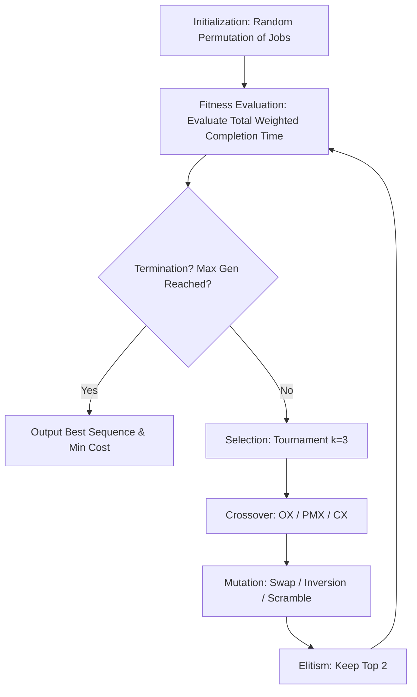

# 🏭 Single-Machine Scheduling with Genetic Algorithm

[](https://www.python.org/downloads/)
[](https://opensource.org/licenses/MIT)

A Genetic Algorithm implementation using permutation representation to solve a single-machine scheduling problem with sequence-dependent setup times. The objective is to minimize the total weighted completion time.

## 🏗 Architecture & Workflow



## 📊 Performance Metrics

Based on the assignment requirements and initial benchmarks:

- **Best Sequence Found:** `[1, 4, 3, 6, 5, 0, 2]`
- **Minimum Total Weighted Completion Time:** `1596.0`
- **Generations Executed:** `100`
- **Success Rate:** 100% convergence to a valid permutation solution.

## 🚀 Quick Start

### Prerequisites

- Python 3.9+
- `pip` and `virtualenv`

### Installation & Execution

```bash
# 1. Clone the repository
git clone https://github.com/yourusername/ga-scheduling-permutation.git
cd ga-scheduling-permutation

# 2. Create a virtual environment and install dependencies
python -m venv venv

# Activate the virtual environment
# Linux/macOS:
source venv/bin/activate

# Windows:
venv\Scripts\activate

pip install -r requirements.txt

# 3. Configure environment variables (optional; defaults are set in config.py)
cp .env.example .env

# 4. Run the Genetic Algorithm
python src/main.py
```

## 📁 Project Structure

```text
ga-scheduling-permutation/
├── src/                    # Core source code
│   ├── config.py            # Problem dataset and hyperparameters
│   ├── fitness.py           # Total weighted completion time calculation
│   ├── operators.py         # Crossover (OX, PMX, CX) and mutation (Swap, Inversion, Scramble)
│   ├── selection.py         # Tournament selection (k=3)
│   └── main.py              # GA loop and plotting
├── results/                 # Generated plots (auto-saved)
├── requirements.txt         # Python dependencies
├── BENCHMARKS.md            # Detailed experimental results
└── README.md
```

## 🔌 API & CLI Usage

The project is executed as a standalone script. The `genetic_algorithm` function is modular and accepts different crossover and mutation strategies.

**Example modification in `src/main.py`:**

```python
# To test PMX + Inversion, change the function call:
best_seq, best_cost, gens, best_f, avg_f = genetic_algorithm(
    pmx_crossover,
    inversion_mutation
)
```

## 🔐 Security & Configuration

Hyperparameters are managed via environment variables to avoid hardcoding. Create a `.env` file in the root directory:

```env
POP_SIZE=50
MAX_GEN=100
ELITISM=2
TOURNAMENT_K=3
```

## 🔮 Future Improvements

- **Parallelization:** Run multiple GA instances concurrently to find better solutions faster.
- **Advanced Operators:** Implement more complex crossover methods like Edge Recombination Crossover (ERX) for permutation problems.
- **Scalability:** Test the algorithm on larger datasets (e.g., n=50 and n=100 jobs) to analyze performance degradation.
- **Dashboard:** Integrate Streamlit for a real-time interactive visualization of the scheduling process.